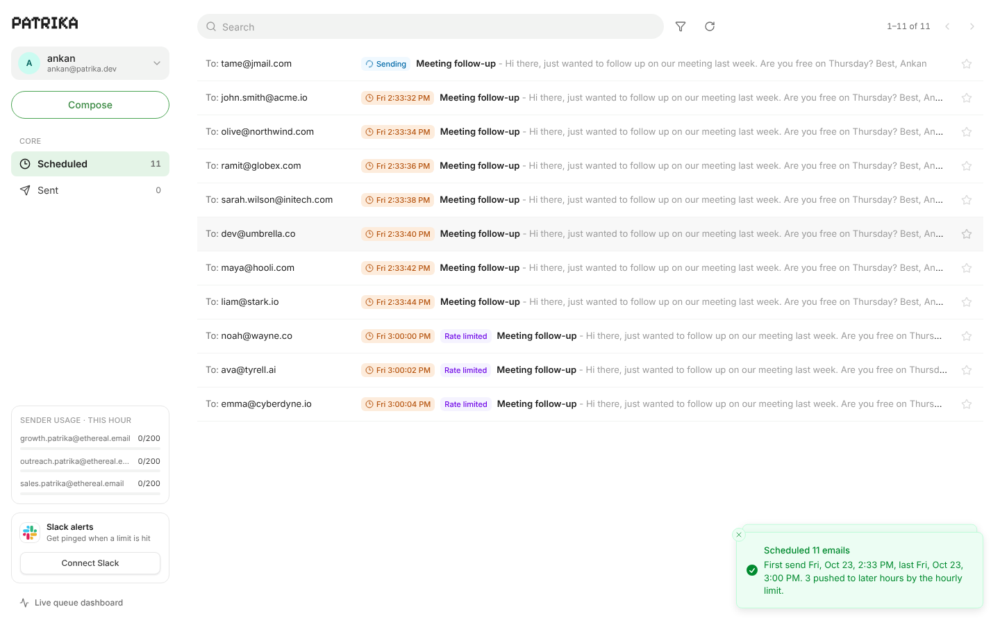
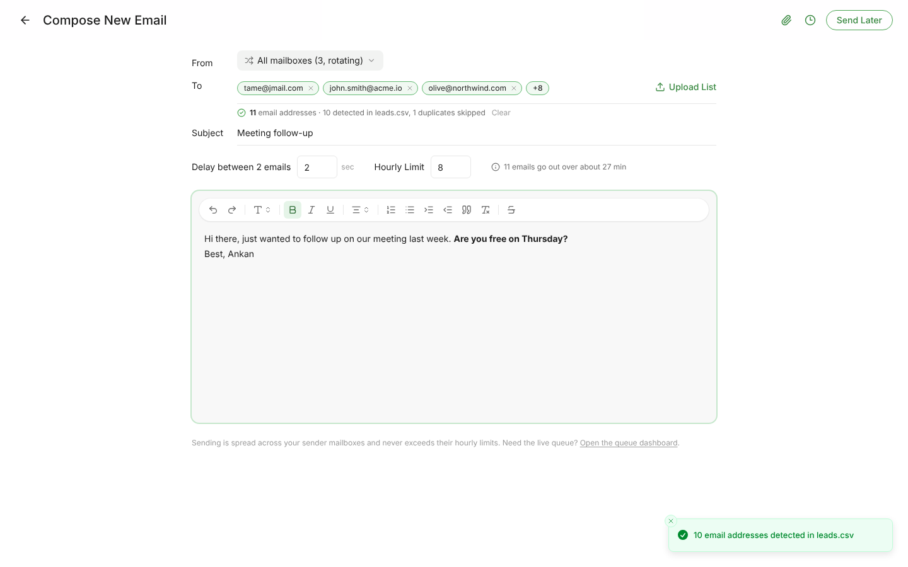
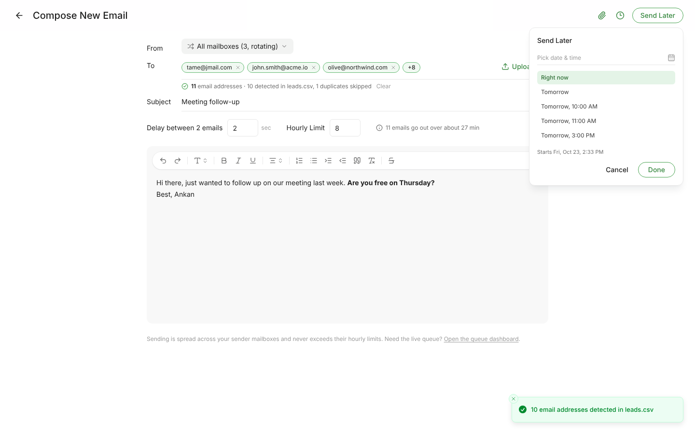
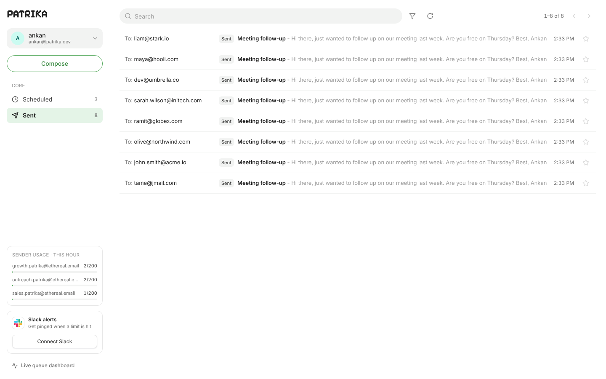
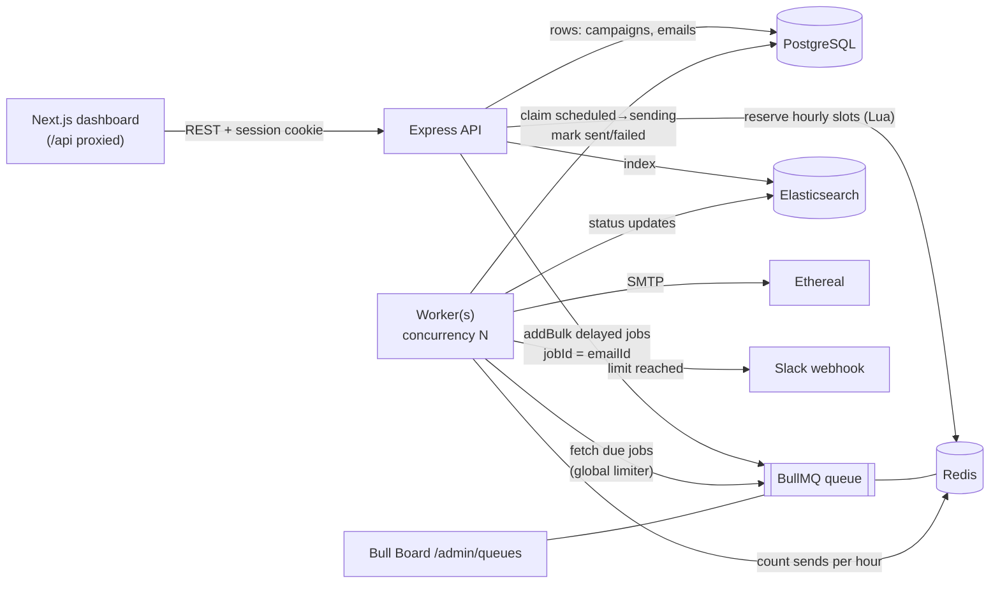

# Patrika

**Patrika** is an email campaign scheduler with a dashboard. It accepts send requests, schedules every email
for an exact time using **BullMQ delayed jobs on Redis** (no cron), sends through **Ethereal SMTP**, and keeps
going through restarts without losing an email or sending one twice.

| Scheduled | Compose |
| --- | --- |
|  |  |
| **Send later** | **Sent** |
|  |  |

---

## Contents

1. [Features](#features)
2. [Tech stack](#tech-stack)
3. [Running it locally](#running-it-locally)
4. [Configuration](#configuration)
5. [Architecture](#architecture)
6. [API](#api)
7. [Tests](#tests)
8. [Demo script](#demo-script)
9. [Assumptions & trade-offs](#assumptions--trade-offs)

---

## Features

### Backend

| Requirement | How Patrika does it |
| --- | --- |
| Accept scheduling requests via API | `POST /api/campaigns` validates the input (zod), stores one row per recipient in Postgres and enqueues one delayed BullMQ job per email |
| Persistent scheduler, no cron | BullMQ `delay` jobs in Redis (AOF on). No cron, `node-cron`, `agenda` or repeatable jobs |
| Survives restarts | Jobs live in Redis; Postgres is the source of truth; the worker reconciles on boot ([details](#persistence--restarts)) |
| No duplicates (idempotency) | Job id = email id, an atomic `scheduled → sending` claim in Postgres, an idempotency key on campaign creation ([details](#idempotency)) |
| Multiple senders via Ethereal | Several Ethereal mailboxes are created on first boot (or supplied in env); emails rotate across them, or the user picks one in **From** |
| Worker concurrency | `WORKER_CONCURRENCY` (default 5) per worker process; any number of processes can run |
| Minimum delay between sends | BullMQ limiter, stored in Redis and shared by all workers: **at most 1 send every 2 s** (`MIN_DELAY_BETWEEN_SENDS_MS=2000`) |
| Emails per hour | Per sender (`MAX_EMAILS_PER_HOUR_PER_SENDER`, default 200) **and** per campaign (the compose form's *Hourly Limit*), enforced by an atomic Redis Lua script ([details](#rate-limiting)) |
| Over the limit → delay, never drop | Emails are moved into the next hour that has room, keeping their order |
| Slack alert when a limit is hit | Real Slack OAuth ("Connect Slack") stores an incoming webhook per user; the worker posts the moment a sender or campaign reaches its hourly limit |
| Searchable via Elasticsearch | Every email is indexed and kept in sync when its status changes; search uses Elasticsearch and falls back to Postgres if it is down |
| Live BullMQ dashboard | Bull Board at **`/admin/queues`** (signed-in users only) |

### Frontend (Next.js 16, React 19, Tailwind CSS 4, TypeScript)

| Requirement | Where |
| --- | --- |
| Google login (real OAuth), plus email sign-up from the design | `/login`: name, email and avatar in the user card, **Log out** in its menu |
| Dashboard: Scheduled / Sent with counts, Compose button | `/dashboard/scheduled`, `/dashboard/sent` |
| Compose: subject, rich-text body, CSV/TXT upload with detected count, start time, delay, hourly limit | `/compose`, with the **Send Later** popover (date-time picker + presets) |
| Scheduled table: email, subject, scheduled time, status | Time chips; a **Rate limited** badge on emails that the hourly limit moved |
| Sent table: email, subject, sent time, sent/failed | Grey *Sent* / red *Failed* chips; the failure reason is shown on hover and on the email page |
| Loading, empty and error states, toasts | Skeleton rows, empty states with calls to action, retry buttons, `sonner` toasts |
| Extras | Elasticsearch search box, filters (starred, failed, …), stars, attachments, sender usage meters, live refresh, mobile layout |

---

## Tech stack

| Layer | Choice |
| --- | --- |
| API & worker | Node 20+, **TypeScript**, **Express 5**, **BullMQ 5**, ioredis, Nodemailer, zod, pino |
| Database | **PostgreSQL 16** with **Drizzle ORM** (SQL migrations in `backend/drizzle`) |
| Queue / rate limits | **Redis 7**, AOF persistence, `noeviction` |
| Search | **Elasticsearch 8** |
| Frontend | **Next.js 16** (App Router), React 19, **Tailwind CSS 4**, TanStack Query, lucide icons |
| Infra | `docker-compose.yml` for Postgres, Redis and Elasticsearch |

```
patrika/
├── docker-compose.yml        Postgres, Redis (AOF), Elasticsearch
├── backend/
│   ├── drizzle/              SQL migrations
│   ├── src/
│   │   ├── api.ts            HTTP server entrypoint
│   │   ├── worker.ts         BullMQ worker entrypoint
│   │   ├── app.ts            Express app, routes, Bull Board
│   │   ├── auth/             Google OAuth, email+password, sessions (JWT cookie)
│   │   ├── modules/
│   │   │   ├── campaigns/    validation, schedule planner, create flow
│   │   │   ├── emails/       list / search / detail / star / attachments
│   │   │   ├── senders/      Ethereal mailboxes + SMTP transport
│   │   │   └── slack/        OAuth install + notifications
│   │   ├── queue/            queue, processor, Redis rate limiter, reconciliation
│   │   └── lib/              redis, elasticsearch, html sanitizing, time windows
│   └── test/                 unit + integration tests (real Postgres/Redis/SMTP sink)
└── frontend/
    └── src/
        ├── app/              routes: /login, /dashboard/*, /compose, /emails/[id]
        ├── components/       ui/ (Button, Menu, Field, …), layout/, emails/, compose/, slack/
        └── lib/              API client, React Query hooks, types, formatting, CSV parsing
```

---

## Running it locally

**Prerequisites:** Node 20+, npm 10+, Docker. If you'd rather not use Docker, a local Postgres 16, Redis 7 and
Elasticsearch 8 work too; Elasticsearch is optional.

```bash
# 1. Infrastructure
docker compose up -d                 # Postgres :5432, Redis :6379, Elasticsearch :9200

# 2. Dependencies (npm workspaces: backend + frontend)
npm install

# 3. Environment
cp backend/.env.example backend/.env       # then set JWT_SECRET + Google/Slack credentials
cp frontend/.env.example frontend/.env     # BACKEND_URL, defaults to http://localhost:4000

# 4. Run API + worker + dashboard together
npm run dev
```

| Process | URL / command |
| --- | --- |
| Dashboard | http://localhost:3000 |
| API | http://localhost:4000/api (also reachable through the dashboard at `/api`) |
| Bull Board | http://localhost:3000/admin/queues |
| Health | http://localhost:3000/api/health |

Migrations run automatically when the API or worker starts, under a Postgres advisory lock. `npm run
db:migrate -w backend` runs them by hand. On first boot the API creates `SENDER_COUNT` Ethereal mailboxes and
stores them, so the same mailboxes are reused after every restart.

To run the pieces separately (e.g. several workers):

```bash
npm run dev:api -w backend
npm run dev:worker -w backend     # start this as many times as you like
npm run dev -w frontend
```

Production build: `npm run build`, then `npm run start:api -w backend`, `npm run start:worker -w backend` and
`npm run start -w frontend`.

---

## Configuration

All backend settings live in `backend/.env` (see [`backend/.env.example`](backend/.env.example)) and are
validated at startup.

| Variable | Default | Meaning |
| --- | --- | --- |
| `APP_URL` | `http://localhost:3000` | Public URL of the dashboard. OAuth redirects are built from it |
| `JWT_SECRET` | – | Signs session cookies and OAuth `state` (≥16 chars; `openssl rand -hex 32`) |
| `DATABASE_URL`, `REDIS_URL` | local docker | Connection strings |
| `ELASTICSEARCH_URL` | – | Leave empty to disable Elasticsearch (search then uses Postgres) |
| `WORKER_CONCURRENCY` | `5` | Jobs processed in parallel per worker process |
| `MIN_DELAY_BETWEEN_SENDS_MS` | `2000` | Minimum gap between any two sends across all workers |
| `MAX_EMAILS_PER_HOUR_PER_SENDER` | `200` | Hard hourly cap per sender mailbox |
| `MAX_CAMPAIGN_HOURLY_LIMIT` | `1000` | Highest hourly limit a user can enter in the compose form |
| `SEND_ATTEMPTS` | `3` | SMTP attempts (exponential backoff from 30 s) before an email is marked failed |
| `ETHEREAL_SENDERS` | – | Optional `user:pass,user:pass` Ethereal logins. Empty = auto-create `SENDER_COUNT` |

### Ethereal Email

Nothing to set up: the API creates Ethereal accounts through Ethereal's API on first boot. To use your own,
create accounts at <https://ethereal.email/create> and list them in `ETHEREAL_SENDERS`. Every sent email gets an
Ethereal preview link: the ↗ icon on the email page.

### Google OAuth

1. Google Cloud Console → *APIs & Services* → *Credentials* → **Create OAuth client ID** (Web application).
2. Authorized redirect URI: `http://localhost:3000/api/auth/google/callback` (i.e. `${APP_URL}/api/auth/google/callback`).
3. Put the client id and secret in `GOOGLE_CLIENT_ID` / `GOOGLE_CLIENT_SECRET`.

### Slack

1. <https://api.slack.com/apps> → **Create New App** → *From scratch*.
2. *OAuth & Permissions* → add the **`incoming-webhook`** scope and the redirect URL `${APP_URL}/api/slack/callback`.
3. Slack only accepts **https** redirect URLs, so expose the dashboard through a tunnel
   (`ngrok http 3000` or `cloudflared tunnel --url http://localhost:3000`) and set `APP_URL` to the https URL.
   Add that URL as a Google redirect URI too.
4. Put the app's client id and secret in `SLACK_CLIENT_ID` / `SLACK_CLIENT_SECRET`.
5. In the dashboard click **Connect Slack**, pick a channel, and you get a confirmation message. **Send test**
   checks the webhook at any time.

---

## Architecture



### How scheduling works

1. **Compose → API.** The dashboard posts subject, sanitized HTML body, recipients, start time, delay between
   emails and hourly limit (plus an idempotency key, an optional sender and attachments).
2. **Planning** (`backend/src/modules/campaigns/planner.ts`). Recipients are de-duplicated and planned in order:
   email *i* is due at `max(start + i × delay, previous + delay)`. For each email the API asks the
   [rate limiter](#rate-limiting) to **reserve a slot** in that clock hour for the campaign and for a sender with
   room left. If the hour is full, the email moves to the start of the next hour with room. So the times you see
   in **Scheduled** are the real send times, including rate-limit deferrals.
3. **Persist, then enqueue.** Campaign, emails and attachments go into Postgres in one transaction. Then one BullMQ
   job per email is added with `delay = scheduledAt − now` and **`jobId = email.id`**.
4. **Sending** (`backend/src/queue/processor.ts`). When a job comes due, a worker:
   - loads the email, and skips it if it is already `sent`/`failed`;
   - if the job runs in a different hour than the one it reserved (it is late because workers were down), it
     reserves again. If the current hour is full it **moves the job to the next free hour** (`moveToDelayed`) and
     updates `scheduled_at`; it never fails or drops it;
   - **claims** the email with `UPDATE … SET status='sending' WHERE id=$1 AND status='scheduled'`;
   - sends over SMTP (pooled transport per sender, Message-ID `<emailId@patrika.local>`);
   - marks it `sent` (or `failed` after `SEND_ATTEMPTS`) in Postgres and Elasticsearch, and counts the send in
     Redis. When that count reaches a limit, it posts the Slack alert.

### Persistence & restarts

- **Redis holds the schedule.** Delayed jobs live in Redis with **AOF persistence** (`appendonly yes`,
  `appendfsync everysec`) and `noeviction`. Stopping the API or worker loses nothing. When the worker comes back,
  BullMQ promotes every job whose time has passed and keeps the rest waiting until their time. Nothing restarts
  from the beginning, because only the jobs that still exist are processed.
- **Postgres is the source of truth.** On boot, every worker runs `reconcileScheduledEmails()`. Each row still
  `scheduled` must have a job. If one is missing (Redis data lost, or the API crashed between commit and
  enqueue), it is re-created with its original time. Because the job id is the email id, this can never
  duplicate an existing job.
- **Graceful shutdown.** `SIGTERM`/`SIGINT` calls `worker.close()`, which finishes in-flight sends before exiting.
  A crash mid-send leaves a *stalled* job, which BullMQ hands to another worker; see below for how that stays
  duplicate-free.

### Idempotency

| Risk | Guard |
| --- | --- |
| User double-clicks **Schedule** / retries the request | `idempotency_key` per compose session, unique per user → the second request returns the first campaign (`200`, `duplicate: true`) |
| Same recipient twice in a list | De-duplicated before planning, plus a unique index on `(campaign_id, recipient)` |
| Same email enqueued twice (retry, reconciliation) | `jobId = emailId`, so BullMQ ignores the second add |
| Two workers pick up the same email | Conditional claim `status='scheduled' → 'sending'`; only one `UPDATE` matches |
| Job re-run after the email was sent | Processor exits early on `sent`/`failed` |
| Crash after SMTP accepted the message, before Postgres was updated | `sentMessageId` is written to the job data first; the retry just finishes the bookkeeping |
| Crash *during* the SMTP conversation (unknowable outcome) | Marked `failed` with a clear reason instead of resending: **at-most-once** wins over a possible duplicate |

### Rate limiting

**Minimum delay between sends:** BullMQ's worker `limiter: { max: 1, duration: MIN_DELAY_BETWEEN_SENDS_MS }`
(default **one send every 2 seconds**). The limiter's state is in Redis, so the gap holds across every worker
process and every concurrency slot. Each campaign's own *Delay between emails* is also applied when its send
times are planned.

**Emails per hour:** two limits apply to every email:

- **per sender mailbox**: `MAX_EMAILS_PER_HOUR_PER_SENDER` (env, default 200);
- **per campaign**: the *Hourly Limit* the user enters when composing.

Windows are fixed clock hours (UTC), with counters keyed `patrika:rl:sender:<id>:<hour>` and
`patrika:rl:campaign:<id>:<hour>`. A single **Lua script** (`backend/src/queue/rateLimiter.ts`) scans forward
from the requested hour for the first hour where the campaign has room **and** some sender has room, then
increments both counters and sets them to expire a day after their hour. Redis runs a Lua script atomically, so
any number of API instances and workers can reserve at the same time without ever overshooting a limit. Nothing
is kept in process memory.

Reservations happen when the campaign is planned, so 1,000 emails over the limit don't hammer the queue
retrying every hour. Each email is parked directly in its future hour. A separate pair of counters records
**actual** sends. The send that brings a counter to exactly the limit triggers the Slack notification
(`INCR` returns that value once, so there is one alert per sender or campaign per hour).

**Behavior under load (1,000+ emails at the same time):** with 3 mailboxes × 200/h and a campaign limit of 500/h,
the planner puts emails 1–500 in the current hour and 501–1000 in the next. Within each hour they are spread by
the campaign delay, and the global limiter paces them at one every 2 s. Order is preserved, nothing is dropped,
and a second campaign scheduled at the same moment queues behind the first for the shared sender capacity.

**Trade-offs:** fixed clock-hour windows are simple and exact to reason about, but allow up to 2× the limit
across an hour boundary (end of one hour + start of the next). A sliding window would close that gap at the
cost of more Redis work. The global limiter is deliberately conservative (one queue-wide gap); a per-sender
throttle would allow more throughput with many mailboxes.

### Slack notifications

- **Connect Slack** → `/api/slack/install` → Slack's consent screen (scope `incoming-webhook`) →
  `/api/slack/callback` exchanges the code (`oauth.v2.access`) and stores the webhook URL, channel and team for
  that user.
- The worker reads the connection from Postgres every time it notifies, so connecting, disconnecting or
  reconnecting works immediately without a redeploy. Users who never connected are skipped silently. A revoked
  webhook (404/410) is removed automatically.
- Notifications are fire-and-forget: a Slack outage never delays or fails an email.

### Search

Emails are indexed in Elasticsearch (`patrika-emails`) when created, and updated on every status change. The
search box queries recipient, subject and body (prefix matching, scoped to the user and the current tab).
Postgres then returns the matching rows in Elasticsearch's order. If Elasticsearch isn't configured or is down,
search falls back to `ILIKE` in Postgres; the UI shows which engine answered.

### Security notes

- Sessions are a signed JWT in an `httpOnly`, `SameSite=Lax` cookie. OAuth `state` is checked for both Google
  and Slack. Passwords use scrypt with a per-user salt. Login attempts are throttled in Redis (10 per 15 min).
- Email HTML is sanitized on the server with an allowlist (`sanitize-html`) and again with DOMPurify before it
  is rendered. Attachments are served with `Content-Security-Policy: sandbox` and `nosniff`.
- Bull Board and all `/api` routes except auth and health require a session.

---

## API

All routes are under `/api` and use JSON. Everything except auth and health requires the session cookie.

| Method | Path | Description |
| --- | --- | --- |
| `GET` | `/health` | Postgres / Redis / Elasticsearch status |
| `GET` | `/auth/google` → `/auth/google/callback` | Google OAuth |
| `POST` | `/auth/email` | `{ email, password }`: sign in, or create the account if the email is new |
| `GET` | `/auth/me` | Current user and Slack connection |
| `POST` | `/auth/logout` | Clear the session |
| `POST` | `/campaigns` | Schedule a campaign (below) |
| `GET` | `/emails?tab=scheduled\|sent&page&pageSize&q&status&starred` | List / search emails |
| `GET` | `/emails/stats` | Counts per status |
| `GET` | `/emails/:id` | Email with body, attachments, delivery details |
| `PATCH` | `/emails/:id/star` | `{ starred }` |
| `GET` | `/attachments/:id` | Download an attachment |
| `GET` | `/senders` | Sender mailboxes with this hour's usage |
| `GET` | `/slack/install` → `/slack/callback` | Slack OAuth |
| `POST` | `/slack/test` | Send a test message |
| `DELETE` | `/slack` | Disconnect Slack |

Schedule a campaign (to try it from Postman, sign in first via `POST /api/auth/email` to get the cookie):

```http
POST /api/campaigns
Content-Type: application/json

{
  "idempotencyKey": "6b0b5d1e-2f6c-4a8e-9a37-0c1f0a3f9d11",
  "subject": "Meeting follow-up",
  "body": "<p>Hi there, are you free on <b>Thursday</b>?</p>",
  "recipients": ["john@acme.io", "olive@northwind.com"],
  "startAt": "2026-10-24T10:00:00+05:30",
  "delayBetweenSeconds": 30,
  "hourlyLimit": 50,
  "senderId": null,
  "attachments": []
}
```

```json
{
  "campaign": { "id": "…", "totalEmails": 2, "…": "…" },
  "duplicate": false,
  "summary": {
    "scheduled": 2,
    "duplicatesRemoved": 0,
    "deferredByHourlyLimit": 0,
    "firstSendAt": "2026-10-24T04:30:00.000Z",
    "lastSendAt": "2026-10-24T04:30:30.000Z"
  }
}
```

---

## Tests

```bash
docker compose up -d postgres redis
npm test
```

The backend suite (Vitest) runs against **real Postgres and Redis** (separate `patrika_test` database and Redis
db 15) and a local SMTP sink in place of Ethereal:

- planner: delay spacing, hourly deferral with order kept, 1,200 emails never exceeding a limit;
- rate limiter: 60 concurrent reservations from 5 connections never overshoot either limit; one alert per hour;
- scheduler: every email sent exactly once; idempotent re-submit; re-enqueue and re-processing don't resend;
  **restart** (worker stopped before emails are due, then restarted); reconciliation of lost jobs; a late job is
  deferred to the next hour instead of failing; SMTP failures retried and then marked failed; chosen sender and
  attachments;
- HTML sanitizing and plain-text conversion.

`npm run typecheck` and `npm run lint -w frontend` cover static checks.

---

## Demo script

1. `docker compose up -d && npm run dev`, open http://localhost:3000 and **Login with Google**.
2. **Connect Slack** in the sidebar and approve. The channel gets a confirmation message.
3. **Compose**: upload a CSV of leads (the detected count appears), set *Delay* = 2 s and *Hourly Limit* = 5,
   write a body, then **Send Later → Right now → Done**.
4. **Scheduled** shows the first 5 at 2 s intervals and the rest at the top of the next hour, tagged
   **Rate limited**. Bull Board (`/admin/queues`) shows the delayed jobs.
5. As emails send they move to **Sent**. Open one and follow the Ethereal ↗ link. After the 5th send, Slack gets
   *"Campaign … reached its hourly limit of 5"*.
6. **Restart**: schedule a campaign 2 minutes ahead, stop `npm run dev` (Ctrl-C), wait until the time has
   passed, start it again. The worker log shows `Startup reconciliation finished … recovered: 0`; the overdue
   emails go out once, and the earlier ones are not resent.

---

## Assumptions & trade-offs

- **One job per email** (rather than one per campaign) keeps every email independently retryable, visible in
  Bull Board and idempotent by id. At 10k recipients that is 10k small Redis entries, which is fine for Redis.
- **Rate-limit windows are UTC clock hours**, shared by all users of a sender mailbox. Sender limits are
  global, since mailboxes belong to the system. Campaign limits belong to the user.
- **At-most-once on crashes mid-SMTP**: an interrupted send is marked failed instead of retried, because a
  possible duplicate is worse than a visible failure for cold outreach.
- **Attachments are stored in Postgres** (max 5 files / 5 MB per campaign) to keep the stack small. A real
  deployment would use object storage.
- **Email + password sign-in** was added because it appears in the design; Google OAuth is the primary
  login. A new email address creates an account ("or sign up through email").
- **Slack requires https redirects**, so local Slack testing needs a tunnel (ngrok/cloudflared).
- The dashboard refreshes by polling every 5 s; WebSockets or SSE would be the next step.
- Elasticsearch is optional at runtime: indexing failures are logged and search falls back to Postgres, so a
  search outage never blocks scheduling or sending.
